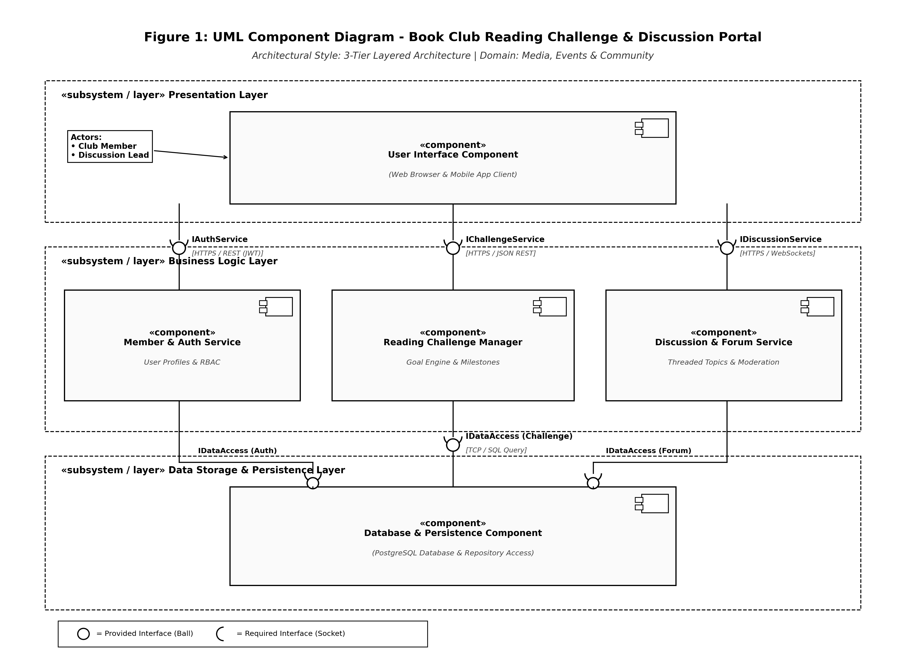

# Lab 3: Component Modelling & Architectural Pattern Selection

- **Student Name:** Pranav Kaushal
- **SRN:** PES2UG24CS363
- **Course:** Software Engineering Lab (SELABS)
- **Topic:** Book Club Reading Challenge & Discussion Portal
- **Primary Domain:** Media, Events & Community
- **Target Actors:** Club Member, Discussion Lead

---

## Architecture Selection
> **"We chose Layered (3-Tier) Architecture for the Book Club Reading Challenge & Discussion Portal System."**

---

## 1. Architectural Choice
We selected a standard **3-Tier Layered Architecture** organized into three decoupled layers:
- **Presentation Layer:** Web and mobile client interface providing dedicated views for Club Members and Discussion Leads.
- **Business Logic Layer:** Application services handling user authentication, reading challenges, and discussion forums.
- **Data Storage Layer:** Relational database (PostgreSQL) managing persistent entities and logs.

---

## 2. Two Reasons for Choice
1. **Functional Separation of Community Modules:** The portal has two distinct responsibilities: calculating reading goals and milestones (gamification) and managing threaded conversations (discussion forum). A layered architecture isolates these concerns into separate business components behind clean interfaces (`IChallengeService`, `IDiscussionService`). Scoring rules or forum moderation logic can be updated independently without affecting the database schema or client user interfaces.
2. **Appropriate Complexity and Operational Reliability:** A microservices architecture introduces unnecessary network latency, complex container management, and distributed transaction issues that are not justified for a club community application. A 3-tier pattern delivers clean modularity, simple deployment, and reliable ACID transactions while handling peak traffic spikes during monthly challenge deadlines.

---

## 3. Security Advantage
**Layered Boundary Isolation & Role-Based Access Control (RBAC):**  
Client devices cannot directly connect to or execute queries against the database. All user requests pass through the business layer, which validates signed JWT tokens and enforces permissions. Discussion Leads are permitted to create challenges, schedule discussion sessions, and moderate topics, while regular Club Members are restricted to logging reading entries and posting comments. Centralized input validation prevents SQL injection and cross-site scripting (XSS).

---

## 4. Performance Benefit
**Application-Tier In-Memory Caching:**  
Community portals are read-heavy (frequent reads of active challenges, leaderboards, and discussion threads). By isolating the business layer from the database, an in-memory caching tier (e.g., Redis) can serve repeated queries directly from memory. This eliminates unnecessary database round-trips and ensures sub-second response times during peak discussion hours.

---

## 5. UML Component Diagram

---

## 6. Components and Interfaces Summary

| Component Name | Layer | Interfaces & Protocols | Key Responsibility |
| :--- | :--- | :--- | :--- |
| **User Interface Component** | Presentation | Requires: `IAuthService`, `IChallengeService`, `IDiscussionService` (HTTPS/REST) | Client views for members and leads |
| **Member & Auth Service** | Business | Provides: `IAuthService` (JWT) Requires: `IDataAccess` (SQL) | User profiles, authentication & RBAC |
| **Reading Challenge Manager** | Business | Provides: `IChallengeService` (REST) Requires: `IDataAccess` (SQL) | Goal tracking, milestones & badges |
| **Discussion & Forum Service** | Business | Provides: `IDiscussionService` (REST/WSS) Requires: `IDataAccess` (SQL) | Threaded posts, comments & moderation |
| **Database & Persistence** | Data | Provides: `IDataAccess` (PostgreSQL Connection Pool) | Persistent storage for entities & logs |

---

## Deliverable Files
- `component_diagram.png`: Clean monochrome UML 2.0 component diagram with ball-and-socket notation
- `Lab3_Architecture_Justification_Report.pdf`: 2-page document (Page 1: Written Justification, Page 2: UML Component Diagram)
